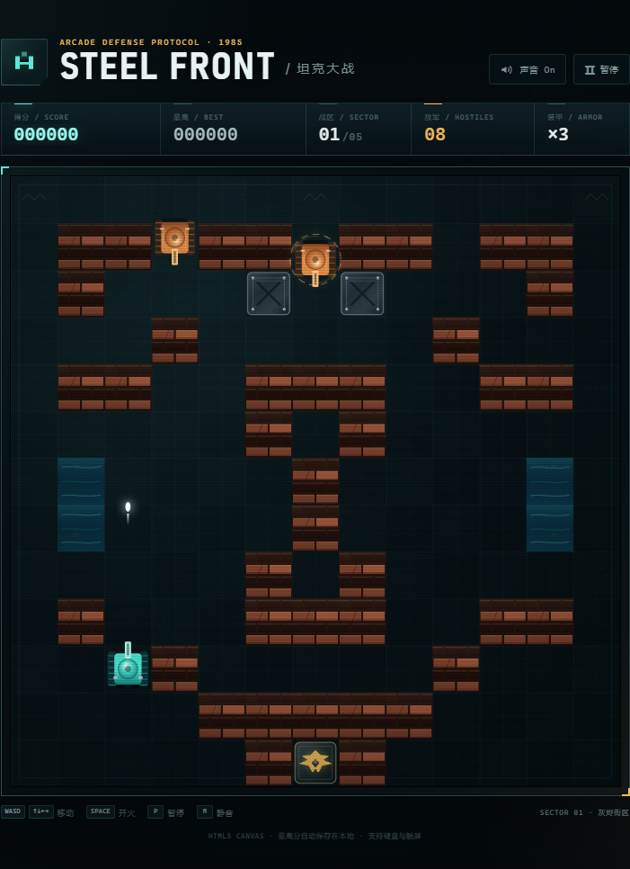

# 钢铁前线 · STEEL FRONT

一款直接在浏览器中运行的 HTML5 Canvas 坦克大战。无需安装、无需构建，也没有任何第三方运行依赖。

> 守住底部指挥核心，扫清五个战区，击退最后一支装甲部队。

## 在线游玩

**<https://wbbb0102.github.io/tank-battle/>**

无需下载或安装，手机和电脑浏览器打开即玩。直接把这个链接发给朋友，或者在游戏主菜单 / 胜利结算页点击「分享」，手机会调起系统分享，电脑会自动复制链接。



## 玩法

- **守住基地**：敌军会穿越街区、击碎砖墙并进攻底部核心。基地被摧毁即任务失败。
- **清除战区**：击败当前关卡全部敌军即可过关。通关五个战区后获得最终胜利。
- **保护装甲**：初始拥有 3 辆坦克。被击毁后可重新部署，装甲耗尽则游戏结束。
- **击毁砖墙**：炮弹可以摧毁砖墙，也会被钢板挡住；水域无法通行，灌木会遮蔽坦克。
- **收集补给**：被击毁的敌军有概率掉落补给，拾取后获得临时能力或额外装甲。

### 五种补给

| 补给 | 效果 |
| --- | --- |
| `S` 能量护盾 | 9 秒无敌护盾 |
| `R` 急速装填 | 10 秒快速射击，弹容量提升 |
| `+` 备用装甲 | 生命 +1 |
| `B` 轨道冲击 | 立即摧毁场上所有敌军 |

### 四种敌军

- **侦察兵**：基础单位，速度与火力均衡。
- **突击车**：移动速度很快，擅长穿插。
- **重装坦克**：拥有三点装甲，需要连续命中。
- **猎手**：射速更快，更倾向于追击玩家。

## 操作

| 操作 | 键盘 |
| --- | --- |
| 移动 | `W` `A` `S` `D` / 方向键 |
| 开火 | `Space` / `J`（按住可连射） |
| 暂停 / 继续 | `P` / `Esc` |
| 静音开关 | `M` |
| 立即重开 | `R`（战斗中） |

在手机或平板上，页面会显示屏幕方向键和开火键，支持同时按住移动与射击。

## 本地运行

项目是纯静态页面，可以直接双击 `index.html` 打开。

也可以启动一个本地服务器：

```bash
python -m http.server 8000
```

然后访问 <http://localhost:8000>。

## 特性

- 五个手绘式 Canvas 战区，最终关设有连续战斗与胜利结算。
- 砖墙、钢板、水域、灌木四种地形及完整炮弹碰撞。
- 敌军 AI 会自动寻路、朝玩家或基地推进、破墙和开火。
- 重装坦克多段装甲、出生保护、玩家复活护盾与三个难度阶段的敌人组合。
- 爆炸、火花、烟雾、冲击波、屏幕震动与履带动画。
- 使用 Web Audio 实时合成射击、命中、爆炸与过关音效，不加载音频文件。
- 支持键盘与触屏，自适应桌面、平板和手机尺寸。
- 最高分与静音偏好通过 `localStorage` 保存在本地。

## 项目结构

```text
.
├── index.html    # 页面结构与游戏界面
├── styles.css    # 响应式视觉、HUD、覆盖层与触屏控制
├── game.js       # 游戏循环、AI、物理、绘制与音效
├── preview.png   # README 预览图
├── LICENSE
└── README.md
```

## 技术说明

游戏使用原生 JavaScript、Canvas 2D 和 Web Audio API。渲染分辨率会跟随元素尺寸与设备像素比自动调整；所有地图、坦克、特效与音效均在运行时绘制/合成，不需要外部资源。支持现代版 Chrome、Edge、Firefox 与 Safari。

## License

[MIT](LICENSE) © 2026 wbbb0102
